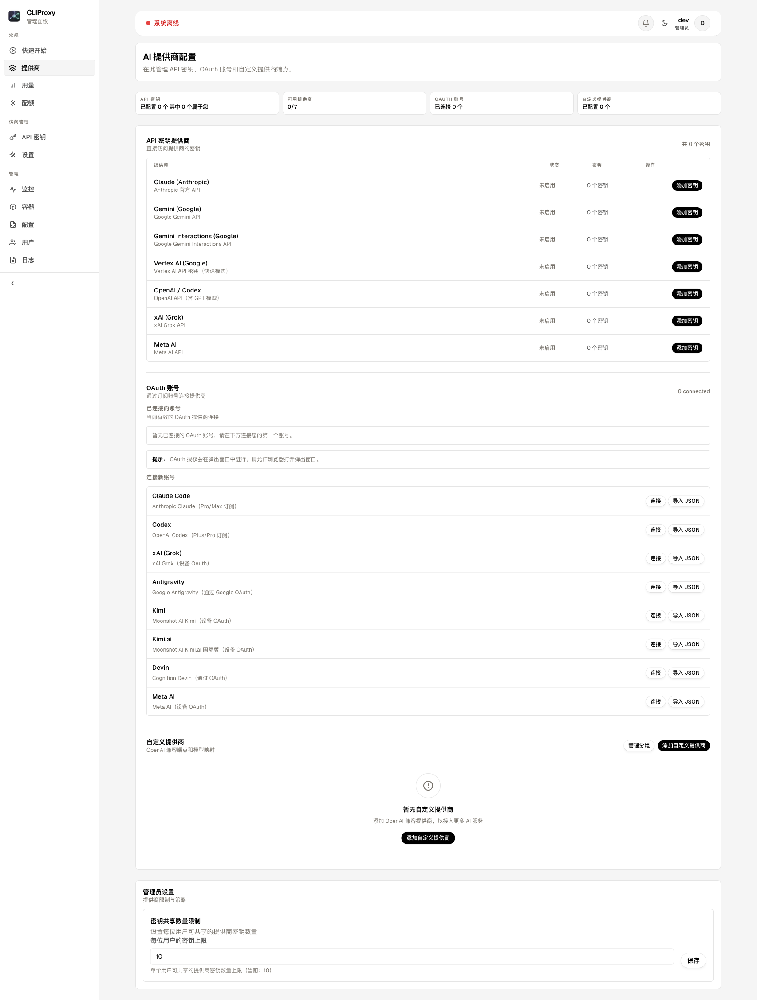
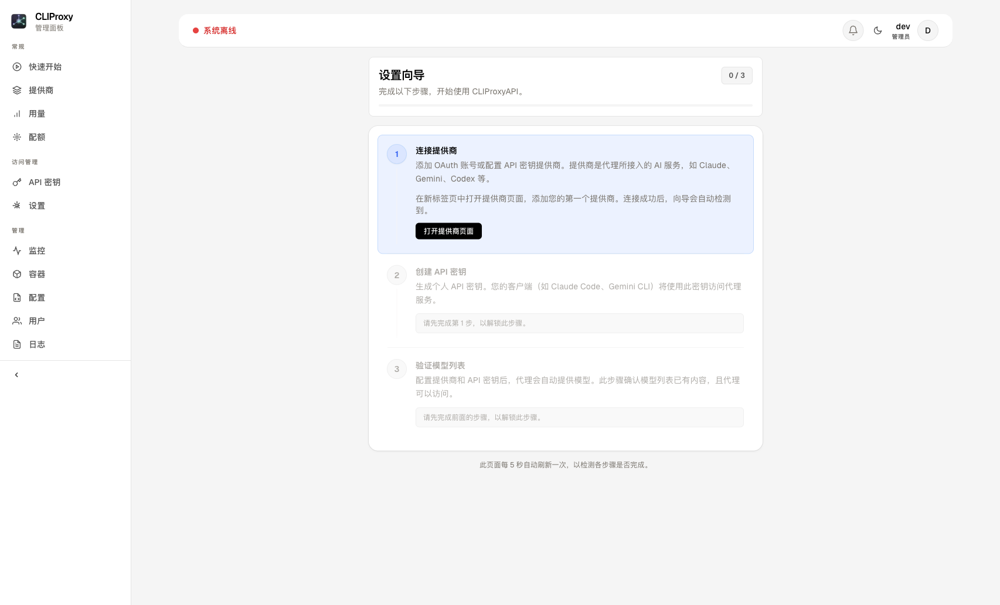
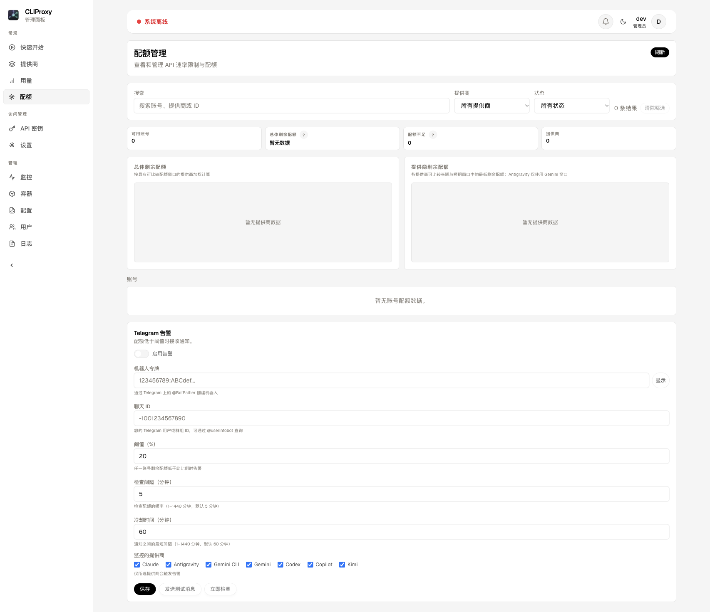
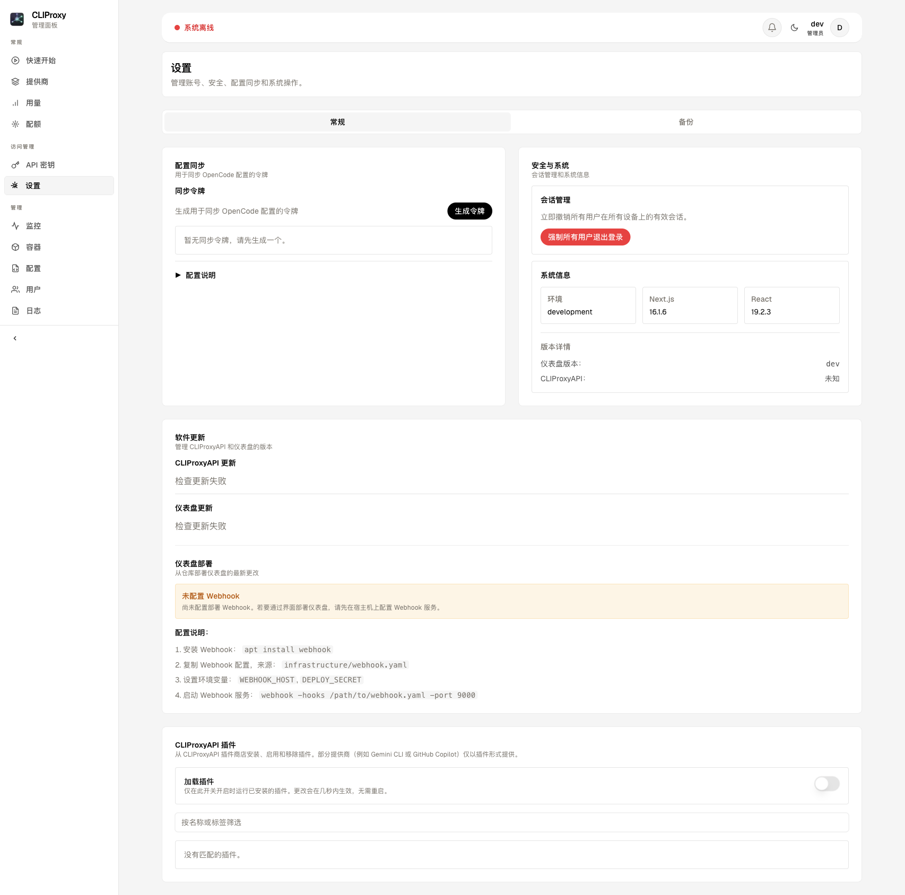

<p align="center">
  
</p>

<h1 align="center">CLIProxyAPI Dashboard</h1>

<p align="center">
  <strong>将 Claude Code、Gemini CLI 和 Codex 作为兼容 OpenAI 的 API 使用，并通过现代化的 Web 仪表盘统一管理。</strong>
</p>

<p align="center">
  <a href="https://github.com/itsmylife44/cliproxyapi-dashboard/releases"></a>
  <a href="https://github.com/itsmylife44/cliproxyapi-dashboard/actions/workflows/release.yml"></a>
  <a href="https://github.com/itsmylife44/cliproxyapi-dashboard/pkgs/container/cliproxyapi-dashboard%2Fdashboard"></a>
  <a href="LICENSE"></a>
  <a href="https://discord.gg/7SrXxNueGA"></a>
  
  
  
</p>

<p align="center">
  <a href="README.md">English</a> | 简体中文
</p>

---

<p align="center">
  <a href="https://discord.gg/7SrXxNueGA">
    
  </a>
</p>
<p align="center">
  欢迎加入 Discord 社区，获取安装帮助、发行公告，并与其他用户交流。<br>
  <strong><a href="https://discord.gg/7SrXxNueGA">discord.gg/7SrXxNueGA</a></strong>
</p>

---

## 项目简介

[CLIProxyAPI](https://github.com/router-for-me/CLIProxyAPI) 将基于 OAuth 授权的 CLI 工具及相关服务封装为**兼容 OpenAI 的 API**，支持 Claude Code、Codex、Antigravity、Kimi、xAI、Devin 等；Gemini CLI、GitHub Copilot、Kiro 和 Cursor 通过 CLIProxyAPI 插件接入。本项目为其提供 Web 管理界面，让您无需编辑 YAML 文件，即可管理提供商、API 密钥、配置、日志和更新。

## 快速开始

> **本地使用（macOS / Windows / Linux）**：只需安装 Docker Desktop。

```bash
git clone https://github.com/itsmylife44/cliproxyapi-dashboard.git
cd cliproxyapi-dashboard
./setup-local.sh          # macOS/Linux
# .\setup-local.ps1       # Windows
```

本地安装脚本会通过 Docker Compose 构建并启动仪表盘（使用 `--build`），因此会包含您当前工作目录中的源码修改。

打开 **http://localhost:3000** → 创建管理员账号 → 即可使用。

> **服务器部署**：请参阅完整的[安装指南](docs/INSTALLATION.md)。如果已经运行 CLIProxyAPI，可使用 `sudo ./install.sh --dashboard-only`，部署仪表盘及其数据库，复用现有 CLIProxyAPI。该模式还包含用量采集和备份调度辅助服务，详见安装指南。

## 功能

- **可视化配置** — 通过结构化表单管理 CLIProxyAPI 设置，无需编辑 YAML。
- **多提供商 OAuth** — 连接 Claude Code、Codex、xAI（Grok）、Antigravity、Kimi、Kimi.ai、Devin 和 Meta AI 账号；启用相应 CLIProxyAPI 插件后，还可接入 Gemini CLI、GitHub Copilot、Kiro 和 Cursor。
- **CLIProxyAPI 插件** — 在“设置”中的插件商店安装、启用、配置和移除插件；缺少插件持久化卷时会显示提示。
- **自定义提供商** — 添加任意兼容 OpenAI 的接口（如 OpenRouter、Ollama），并设置模型映射；管理员可将提供商设为**共享**，供所有团队成员查看和使用。
- **Perplexity Pro Sidecar** — 可选的伴随服务，将 Perplexity Pro 订阅封装为兼容 OpenAI 的接口，可在安装时启用。
- **API 密钥管理** — 创建、撤销和跟踪 API 密钥，并按用户记录归属。
- **用户管理** — 管理员可创建、编辑、删除用户，以及授予管理员权限。
- **实时监控** — 实时日志流、容器健康状态和服务管理。
- **配额跟踪** — 查看各提供商的限额和用量，包括 Claude、Codex（含各模型及代码审查限额）、Kimi、GitHub Copilot，以及 Antigravity 和 Gemini 的各模型配额。
- **Telegram 配额告警** — OAuth 配额低于阈值时自动发送通知，可配置监控提供商、检查间隔和通知冷却时间。
- **用量分析** — 请求次数、提供商用量分布、模型统计、错误率，以及按模型和提供商估算的费用。
- **Oh-My-Open-Agent 版本切换** — 在 [oh-my-openagent](https://github.com/code-yeongyu/oh-my-openagent)（11 个智能体 + 9 个任务类别）与 [oh-my-opencode-slim](https://github.com/alvinunreal/oh-my-opencode-slim)（7 个智能体、更低的 Token 用量、回退链）之间切换，并为各智能体配置模型和技能。
- **配置同步** — 通过 [`opencode-cliproxyapi-sync`](https://github.com/itsmylife44/opencode-cliproxyapi-sync) 插件自动同步 OpenCode 配置，包括 Slim 配置。
- **配置分享** — 通过分享码（`XXXX-XXXX`）向其他用户分享模型配置。
- **一键更新** — 在管理面板中更新 Dashboard（GHCR）和 CLIProxyAPI（Docker Hub）。
- **容器管理** — 直接在界面中启动、停止和重启容器。
- **备份与恢复** — 在“设置 → 备份”中创建、计划、上传、预览和恢复仪表盘备份。
- **明暗主题与多语言** — 支持主题切换，以及英语、德语、西班牙语和简体中文界面。
- **自动 TLS** — 通过 Caddy 获取并自动续期 Let's Encrypt 证书。

> 功能是否可用取决于部署方式。仅部署 Dashboard 时，需要另外提供兼容的 Docker 访问方式和容器命名，才能从仪表盘重启或更新 CLIProxyAPI 容器，详见[安装指南](docs/INSTALLATION.md)。版本切换还需要可写的版本固定配置，详见[环境变量参考](docs/ENV.md)。Dashboard 网页更新则需要部署 Webhook 服务并配置 `DEPLOY_SECRET`，详见 [Webhook / 部署配置](docs/CONFIGURATION.md#webhook--deploy-optional-for-cicd)。

## 本地提供商（Ollama / LM Studio / llama.cpp）

默认情况下，指向 `localhost` 或私有网络的自定义提供商地址会被拦截，以防止托管部署中的 SSRF（服务端请求伪造）。如需在自托管部署中启用这些地址：

1. 在 `infrastructure/.env` 中设置 `ALLOW_LOCAL_PROVIDER_URLS=true`。
2. 重启仪表盘容器（`docker compose up -d dashboard`）。
3. 使用本地基础地址创建自定义提供商。例如，在 Docker 容器内访问 Ollama 时使用 `http://host.docker.internal:11434/v1`；在容器外运行仪表盘时使用 `http://localhost:11434/v1`。API 密钥字段为可选项，提供商不要求密钥时可留空。

无论该设置是否启用，云实例元数据地址（`169.254.169.254`、`100.100.100.200`）都会被拦截。

## Telegram 配额告警

当 OAuth 提供商的剩余配额较低时，通过 Telegram 接收通知。

**设置步骤**（配额 → Telegram 告警，仅管理员可用）：

1. 通过 [@BotFather](https://t.me/BotFather) 创建 Telegram 机器人，并复制机器人令牌。
2. 获取聊天 ID：先向机器人发送消息，再查看 `https://api.telegram.org/bot<TOKEN>/getUpdates`。
3. 在仪表盘中打开**配额**页面，滚动到 **Telegram 告警**，填写：
   - 机器人令牌
   - 聊天 ID
   - 配额阈值，例如剩余 20%
   - 检查间隔和通知冷却时间，单位为分钟
   - 需要监控的提供商：Claude、Antigravity、Gemini CLI、Gemini、Codex、Copilot、Kimi
4. 启用告警。默认每 5 分钟检查一次，两次通知之间的冷却时间为 1 小时。

启用前可使用**发送测试**按钮验证配置，也可使用**立即检查**马上执行一次检查。

## Oh-My-Open-Agent 集成

仪表盘支持两种 OpenCode 智能体编排方案，可通过 **在 OpenCode 中使用** 区域切换：

| 方案 | 智能体 | 说明 |
| --- | --- | --- |
| **Oh-My-Open-Agent** | 11 个智能体 + 9 个任务类别 | 完整的编排方案，包含 sisyphus、hephaestus、atlas、prometheus、oracle 等 |
| **Oh-My-OpenCode Slim** | 7 个智能体 | 轻量方案：orchestrator、oracle、council、designer、explorer、librarian、fixer。Token 用量更低，并提供专用回退链 |

生成的配置面向 oh-my-openagent 5.1.33 和 oh-my-opencode-slim 3.0.4，并使用各自上游的配置 schema 进行校验。

**工作方式：**

1. 在仪表盘中选择方案，`opencode.json` 中的插件会自动切换。
2. 为智能体分配模型，可按层级自动分配，也可手动覆盖。
3. 切换技能设置：Slim 可为每个智能体设置 simplify、codemap；Oh-My-Open-Agent 可设置禁用的技能和钩子。
4. 通过同步插件自动同步配置。

**首次设置**（每种方案只需执行一次）：

```bash
bunx oh-my-openagent@latest install                  # 标准版
bunx oh-my-opencode-slim@latest install --no-tui     # Slim 版
```

两种方案分别使用自己的配置文件（`oh-my-openagent.json` / `oh-my-opencode-slim.jsonc`），互不冲突。

## 截图

<p align="center">
  
  <br><em>设置向导：引导完成初始配置</em>
</p>

<p align="center">
  
  <br><em>提供商配置：管理 API 密钥和 OAuth 账号</em>
</p>

<p align="center">
  
  <br><em>配额管理：跟踪限额，并通过 Telegram 接收告警</em>
</p>

<p align="center">
  
  <br><em>设置：配置同步、系统信息和更新</em>
</p>

## 架构

完整部署包含 7 个 Docker 容器，以及可选的 Perplexity 伴随服务，使用两个网络：`frontend` 和无法访问互联网的 `backend`。

<p align="center">
  
</p>

| 服务 | 作用 |
| --- | --- |
| **Caddy** | 反向代理、自动 TLS、HTTP/3 |
| **Dashboard** | Next.js Web 应用、JWT 身份验证，通过 Docker Socket Proxy 管理 Docker |
| **CLIProxyAPI** | AI 代理服务、OAuth 回调和管理 API |
| **Perplexity Sidecar** | 可选服务（`perplexity` profile）：将 Perplexity Pro 订阅封装为兼容 OpenAI 的接口 |
| **Docker Socket Proxy** | 受限的 Docker API 访问，仅允许容器、镜像和网络相关操作 |
| **PostgreSQL** | 位于隔离内部网络中的数据库 |
| **Usage Collector** | 定时任务容器，每 5 分钟触发一次用量采集 |
| **Backup Scheduler** | 定时任务容器，每 5 分钟检查一次并执行到期的计划备份 |

## 项目结构

<p align="center">
  
</p>

## 技术栈

| 组件 | 技术 |
| --- | --- |
| 框架 | Next.js 16（App Router） |
| 界面 | React 19 |
| 样式 | Tailwind CSS v4 |
| 数据库 | PostgreSQL 16 + Prisma 7 |
| 身份验证 | JWT（jose）+ bcrypt |
| 容器管理 | 通过 Socket Proxy 使用 Docker CLI |

## 开发

```bash
cd dashboard
./dev-local.sh              # 启动开发环境
./dev-local.sh --reset      # 重置数据库
./dev-local.sh --down       # 停止容器
```

也可以手动启动：

```bash
cd dashboard
npm install
cp .env.development .env.local  # 修改其中的数据库连接凭据
npx prisma migrate dev
npm run dev
```

仪表盘地址为 `http://localhost:3000`。

### 仅预览界面（无需数据库）

无需 PostgreSQL 或登录即可浏览仪表盘界面：

```bash
cd dashboard
SKIP_AUTH=1 npm run dev
```

此模式使用模拟管理员身份开放所有路由，适合测试主题、布局和组件。

## 文档

| 指南 | 内容 |
| --- | --- |
| **[安装](docs/INSTALLATION.md)** | 服务器部署、本地设置、手动安装 |
| **[配置](docs/CONFIGURATION.md)** | 环境变量、config.yaml、配置同步 |
| **[环境变量](docs/ENV.md)** | 完整的环境变量参考 |
| **[用量采集](infrastructure/docs/USAGE_COLLECTION.md)** | 用量跟踪服务、故障排查、手动采集 |
| **[故障排查](docs/TROUBLESHOOTING.md)** | 常见问题及解决方法 |
| **[安全](docs/SECURITY.md)** | 生产环境最佳实践 |
| **[备份与恢复](docs/BACKUP.md)** | 自动和手动备份 |
| **[服务管理](docs/SERVICE-MANAGEMENT.md)** | Systemd 和 Docker Compose 命令 |
| **[运维手册](docs/RUNBOOK.md)** | 健康检查、部署、数据库、更新和监控 |

## 参与贡献

1. Fork 仓库 → 创建功能分支 → 提交 PR。
2. 使用 [Conventional Commits](https://www.conventionalcommits.org/) 规范（`feat:`、`fix:`、`chore:`）。
3. 提交前先在本地测试。

Release-Please 会根据提交信息自动生成发行版本。开发环境、脚本、代码风格和 PR 检查清单详见[贡献指南](docs/CONTRIBUTING.md)。

## 贡献者

感谢以下贡献者（[表情符号含义](https://allcontributors.org/docs/en/emoji-key)）：

<!-- ALL-CONTRIBUTORS-LIST:START - Do not remove or modify this section -->
<!-- prettier-ignore-start -->
<!-- markdownlint-disable -->
<table>
  <tbody>
    <tr>
      <td align="center" valign="top" width="14.28%"><a href="https://github.com/itsmylife44"><br /><sub><b>itsmylife44</b></sub></a><br /><a href="#code-itsmylife44" title="Code">💻</a> <a href="#doc-itsmylife44" title="Documentation">📖</a> <a href="#maintenance-itsmylife44" title="Maintenance">🚧</a> <a href="#infra-itsmylife44" title="Infrastructure">🚇</a></td>
      <td align="center" valign="top" width="14.28%"><a href="https://github.com/38lunin021189-creator"><br /><sub><b>Rizki Hidayat</b></sub></a><br /><a href="#code-38lunin021189-creator" title="Code">💻</a></td>
      <td align="center" valign="top" width="14.28%"><a href="https://github.com/dqphong0302"><br /><sub><b>Đặng Quốc Phong</b></sub></a><br /><a href="#code-dqphong0302" title="Code">💻</a></td>
      <td align="center" valign="top" width="14.28%"><a href="https://github.com/smart-tinker"><br /><sub><b>smart-tinker</b></sub></a><br /><a href="#code-smart-tinker" title="Code">💻</a> <a href="#bug-smart-tinker" title="Bug reports">🐛</a></td>
      <td align="center" valign="top" width="14.28%"><a href="https://github.com/islee23520"><br /><sub><b>islee</b></sub></a><br /><a href="#code-islee23520" title="Code">💻</a></td>
      <td align="center" valign="top" width="14.28%"><a href="https://github.com/deftdawg"><br /><sub><b>deftdawg</b></sub></a><br /><a href="#code-deftdawg" title="Code">💻</a> <a href="#bug-deftdawg" title="Bug reports">🐛</a></td>
      <td align="center" valign="top" width="14.28%"><a href="https://github.com/clcc2019"><br /><sub><b>dslife2025</b></sub></a><br /><a href="#code-clcc2019" title="Code">💻</a></td>
    </tr>
  </tbody>
</table>
<!-- markdownlint-restore -->
<!-- prettier-ignore-end -->
<!-- ALL-CONTRIBUTORS-LIST:END -->

## 添加语言

仪表盘支持多语言界面，目前提供**英语（en）**、**德语（de）**、**西班牙语（es）**和**简体中文（zh-CN）**。欢迎社区贡献更多语言！

### 如何贡献新语言

1. **复制英文模板：**
   ```bash
   cp dashboard/messages/en.json dashboard/messages/{locale}.json
   ```
   将 `{locale}` 替换为语言代码，例如法语 `fr`、西班牙语 `es`、日语 `ja`。

2. **翻译所有文本：**
   - 在编辑器中打开新文件。
   - 翻译每个值，保持所有键名和层级结构不变。
   - 示例：
     ```json
     {
       "common": {
         "loading": "Wird geladen...",
         "cancel": "Abbrechen"
       }
     }
     ```

3. **注册新语言：**
   - 编辑 `dashboard/src/i18n/config.ts`。
   - 将语言代码加入 `supportedLocales` 数组：
     ```ts
     export const supportedLocales = ["en", "de", "es", "zh-CN", "fr"] as const;
     ```
   - 在 `localeNames` 中添加显示名称：
     ```ts
     export const localeNames: Record<Locale, string> = {
       en: "English",
       de: "Deutsch",
       es: "Español",
       "zh-CN": "简体中文",
       fr: "Français",  // 新增这一项
     };
     ```

4. **本地测试：**
   - 在 `dashboard/` 目录运行 `npm run dev`。
   - 登录仪表盘。
   - 打开右上角的用户面板。
   - 在语言下拉菜单中选择新语言。
   - 确认界面文本显示正确。

5. **提交 PR：**
   - 标题：`feat(i18n): add {language} translation`。
   - 包含两个文件：`messages/{locale}.json`，以及对 `src/i18n/config.ts` 的修改。
   - 在 PR 说明中附上参考的翻译资源链接或相关备注。

### 翻译质量要求

- 表达简洁，语气与英文版保持一致。
- 使用适合正式或业务场景的语言。
- 测试译文是否导致界面溢出或布局异常。
- 复数和性别形式（如适用）应符合目标语言习惯。
- 日期和时间格式由 `next-intl` 处理，无需修改。
- 保留英文货币代码，例如 `USD`、`EUR`。

### 已支持的语言

| 代码 | 语言 | 状态 |
| --- | --- | --- |
| `en` | 英语 | ✓ 完整 |
| `de` | 德语 | ✓ 完整 |
| `es` | 西班牙语 | 基本完整 |
| `zh-CN` | 简体中文 | 基本完整 |

欢迎按照上述步骤添加更多语言！

## 获取支持

- **[Discord](https://discord.gg/7SrXxNueGA)** — 社区交流、安装帮助和公告。
- **[CLIProxyAPI](https://github.com/router-for-me/CLIProxyAPI)** — 核心代理服务文档。
- **[Issues](https://github.com/itsmylife44/cliproxyapi-dashboard/issues)** — 报告问题或提出功能请求。

## Star 趋势

<a href="https://star-history.com/#itsmylife44/cliproxyapi-dashboard&Date">
  <picture>
    <source media="(prefers-color-scheme: dark)" srcset="https://api.star-history.com/svg?repos=itsmylife44/cliproxyapi-dashboard&type=Date&theme=dark" />
    <source media="(prefers-color-scheme: light)" srcset="https://api.star-history.com/svg?repos=itsmylife44/cliproxyapi-dashboard&type=Date" />
    
  </picture>
</a>

## 许可证

[MIT](LICENSE)

---

<p align="center">
  基于 Next.js、React 和 Tailwind CSS，用心构建 ❤️
</p>
